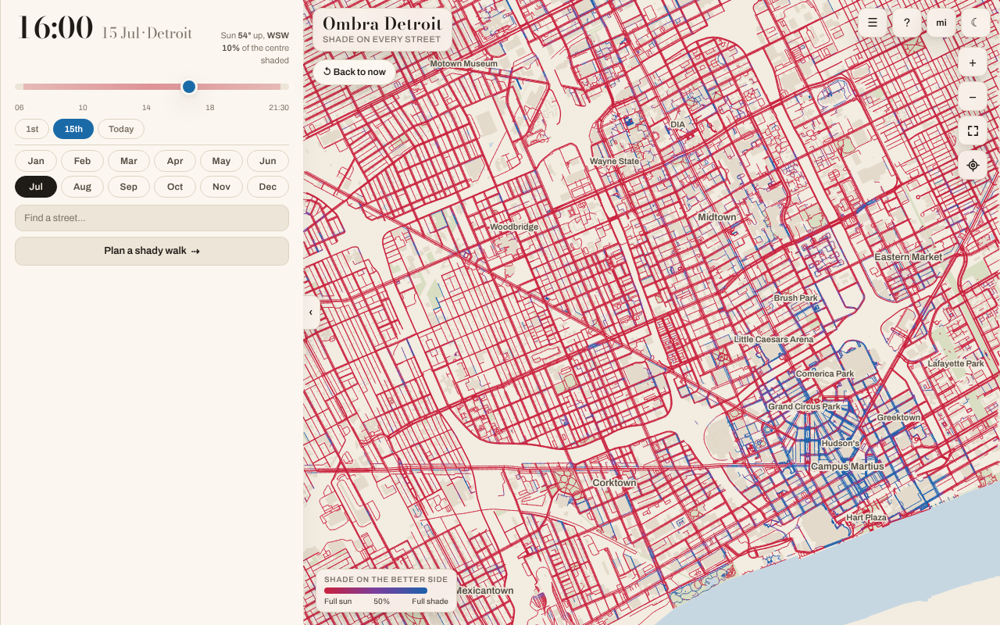

# Ombra Detroit

A street-by-street shade map of downtown Detroit, Midtown, New Center, Corktown,
Mexicantown and the riverfront, and walking routes that prefer the shady side. One self-contained
HTML file — no server, works offline.

Blue is shaded, red is open sun. Scrub the time and date; tap any street to
see its whole day; give it two endpoints and it will trade a short detour for a
lot less sun.

A port of [Ombra Roma](https://github.com/ptrestler/ombra). The city lives in
`city.py`; everything else is shared.



## Build

```bash
pip install -r requirements.txt
npm install
npx playwright install chromium webkit    # both; make test needs WebKit too
make            # ~10 min; the map and elevation data is already cached in data/
make test
open dist/ombra-detroit.html
```

`make fetch` refreshes the data and is the only step that needs the network.
The map data comes from Overture Maps on S3 (`fetch_overture.py`, about a
minute) or straight from OpenStreetMap (`fetch_osm.py`, an hour or more on
public Overpass mirrors); `SOURCE` in `city.py` picks one.

## Open it

**<https://ptrestler.github.io/ombra-detroit/>** — the live page, rebuilt and
redeployed by CI on every push to `main`. Works on a phone, and because it is a
top-level page rather than an embedded frame it can use your location.

## Just give me the file

**[Download the page](https://github.com/ptrestler/ombra-detroit/releases/download/build/ombra-detroit.html)**
— one self-contained 9 MB file, no build needed. Open it in any browser. It
works offline, and unlike the hosted copy it can use your location.

That link is a release asset, rebuilt and replaced by CI on every push to
`main`, so it is always the current build and the URL never changes.

**Open it in a browser, not a file previewer.** iOS Quick Look and the Google
Drive app will render it and then refuse to let you touch it — they are
document viewers, and this is an interactive canvas. On a phone, use the link
above instead.

## What it actually computes

Building footprints from OpenStreetMap, heights for 95 % of them from Esri
Community Maps, USGS lidar, OSM tags and Microsoft's ML buildings (all via
Overture Maps), the towers drawn from their mapped parts, tree canopy measured
from satellite imagery (in leaf May to October),
bare-earth terrain from USGS 3DEP, and NOAA solar geometry. Rays are cast from
both sidewalks of every street at 768 sun positions; the number you see assumes
you walk on the shadier side.

Sanity check: at 2 pm on 15 August, Bagley Street through Corktown and
Mexicantown is 10 % shaded — by its trees, not its two-storey buildings — and
Griswold Street in the Financial District is 89 % shaded at 10 am. That is the
right answer for both.

See `CLAUDE.md` for the pipeline, the measured accuracy, and the things that will
bite you.

## Licence / attribution

Map data © OpenStreetMap contributors, ODbL, via the Overture Maps Foundation.
Building heights from Esri Community Maps (CC BY 4.0), USGS 3DEP lidar and
Microsoft ML Buildings (ODbL), as distributed by Overture. Places © Overture
Maps Foundation. Elevation data courtesy of the USGS 3D Elevation Program via
AWS Open Data. Tree canopy heights © Meta and World Resources Institute
(CC BY 4.0), from their global 1 m canopy height map.
